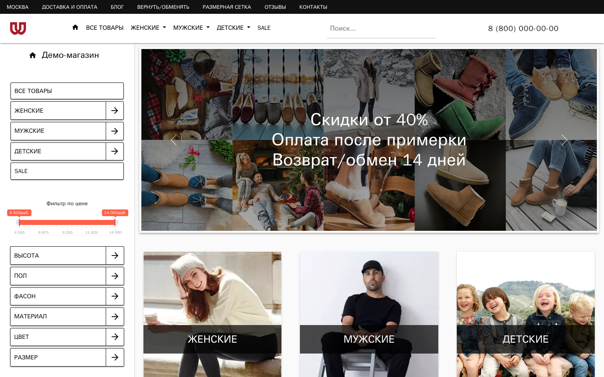

# Демо-магазин

Интернет-магазин обуви на собственном движке **ishop**. Архив состояния на **24 октября 2021** — последняя правка кода перед тем, как проект был остановлен.

Репозиторий — это сохранение кода, а не действующий магазин.

## Статус проекта

- Магазин закрыт, поддержка не ведётся с осени 2021.
- Домен проекта продан вместе с магазином, владелец перестал его вести. В 2026 году регистрация истекла: домен перерегистрирован третьим лицом, сейчас на нём чужой сайт, к проекту он отношения не имеет. Поэтому домен в описании не указывается — ссылаться на него нет смысла.
- Кода на домене нет: все старые пути (`/cart/`, `/adminlte/`, картинки каталога) отдают 404.
- Единственная сохранившаяся копия — этот архив. Оригинального git у проекта не было: код хранился папками и zip-слепками, поэтому история здесь восстановлена по датам файлов (см. «Хронология»).

## Стек

- PHP 7.x (разработка велась на 7.0), MySQL
- Движок — `vendor/ishop/core`: роутер, контроллеры, модели, вьюхи, кэш, GeoIP, интеграции СДЭК и reCAPTCHA. Собственная сборка, развивался вместе с магазином — см. «Происхождение движка».
- RedBean PHP (ORM), Valitron (валидация), SwiftMailer 5.4 (почта), TCPDF 6.2 (PDF), PhpSpreadsheet 1.9 (Excel), GeoIP2/MaxMind (регион по IP)
- Админка — AdminLTE 2 (лежит в `public/adminlte`, включая `bower_components`)

## Структура

```
app/
  controllers/        публичные контроллеры (Cart, Product, Category, Search, Api, Vozvrat …)
  controllers/admin/  админка (25 контроллеров)
  models/             модели на RedBean + ручные выборки
  views/              шаблоны страниц
  widgets/            виджеты: корзина, товар, фильтр, мегаменю, хлебные крошки
config/
  init.php            константы, пути, старт сессии
  params.php          параметры магазина (SMTP, СДЭК, размеры картинок, SEO, доставка)
  routes.php          маршруты
  config_db.example.php  пример подключения к БД
public/
  index.php           точка входа
  images/             статика оформления; каталог фото — пустой (см. ниже)
  css/, js/, fonts/, menu/, megamenu/, filter/   фронтовая статика
  adminlte/           тема админки
vendor/ishop/         движок (обязателен, в Composer его нет)
tmp/cache/            кэш, создаётся на месте
```

## Чего в репозитории нет

Сознательно исключено — это наполнение, а не код:

- `public/images/product`, `category`, `news`, `topslider` — ~970 МБ фотографий товаров и баннеров (в каталоге остались только пустые папки с `.gitkeep`);
- `public/upload` — загруженные из админки файлы;
- `public/assets*`, `public/old_old_assets` — кэш собранных CSS/JS;
- `public/yxml_*.xml` — выгрузка каталога для Яндекс.Маркета;
- `vendor/*` кроме `ishop` — ставятся `composer install` по `composer.lock`;
- логи, `nbproject/`, `composer.phar`, архивы, служебные заметки.

## Развёртывание

1. `composer install` — восстановит RedBean, SwiftMailer, TCPDF, PhpSpreadsheet, GeoIP2 и сгенерирует `vendor/autoload.php`.
2. `cp config/config_db.example.php config/config_db.php` и прописать свои доступы к MySQL.
3. Создать базу и импортировать схему из `docker/schema/`: `020-schema-2023.sql` — рабочая схема (51 таблица, дамп от 13.07.2023), `010-schema-2018.sql` — более ранняя (41 таблица), оставлена как исторический слепок. В обеих нет данных — только структура. Четыре сущности, которые встречаются в коде, но отсутствуют и в позднем дампе (`productclass`, `options`, `optionsgrupp`, `related_product`), восстанавливаются по моделям в `app/`.
4. Создать каталоги для картинок и дать права на запись:
   `mkdir -p public/images/product/{1500,1000,300,160,original,parsimg} && chmod -R 775 tmp/cache public/upload public/images`
   Структура папок под размеры задаётся в `config/params.php` (`img_property`), имена должны совпадать.
5. Веб-сервер смотрит в корень проекта, `.htaccess` перенаправляет всё в `public/`.
6. Ключи интеграций (SMTP, СДЭК, reCAPTCHA, Яндекс.Карты) в `config/params.php` вычищены — нужны свои.

Требования: PHP 7.x с расширениями `pdo_mysql`, `gd`, `mbstring`, `zip`; MySQL 5.6+.

## Лицензия

Код проекта (`app/`, шаблоны, движок `vendor/ishop`) — MIT, см. `LICENSE`. Права на сторонние библиотеки остаются у их авторов: AdminLTE 2 и её `bower_components` (файлы `LICENSE` внутри пакетов), RedBean PHP, Valitron, SwiftMailer, TCPDF, PhpSpreadsheet, GeoIP2/MaxMind — ставятся через Composer.

## Происхождение движка и границы авторства

Чтобы не было догадок, что здесь чьё:

- `vendor/ishop/core` — движок магазина собственной сборки: `App`, `Router`, `Registry`, `Db`, `Cache`, `ErrorHandler`, `Geoip`, `Link`, `Recaptcha`, `base/{Controller,Model,View}`, `libs/*`. Развивался вместе с магазином и расширялся под его задачи; часть решений в нём типовая для самописных MVC середины 2010-х, и это не скрывается.
- Магазинная часть — контроллеры, модели, вьюхи, виджеты, интеграции — писалась под конкретный магазин. Что именно: 17 публичных контроллеров (`Cart`, `Product`, `Category`, `Search`, `Citypage`, `Comment`, `Vozvrat`, `Api` …), 25 контроллеров админки, 11 моделей, виджеты (`cartmini`, `product`, `filter`, `megamenu`, `Breadcrumbs`, `Sort`), расчёт и выбор пунктов выдачи СДЭК, определение региона заказа по IP (GeoIP), импорт/экспорт Excel, счета в PDF (TCPDF), выгрузка каталога для Яндекс.Маркета (YML), SEO-ссылки (`Seourl`), городские страницы, фильтры и мегаменю.
- Сторонние библиотеки — RedBean, Valitron, SwiftMailer, TCPDF, PhpSpreadsheet, GeoIP2/MaxMind, Bootstrap и тема AdminLTE 2. Они лежат как есть, со своими лицензиями.

Правовой статус: магазин и домен были проданы заказчику как копия, исключительные права на код не передавались. Домен к проекту больше не относится.

## Хронология

Git-истории у проекта не было, поэтому даты ниже — по времени последней правки файлов в сохранившейся копии (слабое, но проверяемое свидетельство: mtime меняется при копировании):

- 2012 — 1 файл, 2014 — 34, 2015 — 5, 2016 — 16, 2017 — 54, 2018 — 100, 2019 — 93, 2020 — 90, 2021 — 172.

Отсюда видно, что в этой копии непрерывная работа прослеживается с 2014 по октябрь 2021 года, с ростом объёма после 2017-го. Более ранние версии (2011–2013) в сохранившихся слепках почти не представлены; если они найдутся, хронология будет уточнена.

История коммитов в репозитории — реконструкция: коммиты сгруппированы по годам последней правки файлов, даты коммитов соответствуют этим годам, содержимое — финальное состояние 2021 года. Это не оригинальная история разработки, и выдавать её за неё нельзя.

## Тираж движка

Движок не остался в одном магазине: после переработки он тиражировался на другие проекты (ещё семь магазинов). Поэтому сравнивать Демо-магазин с ними можно только в одну сторону — как «что было сделано после тиража», а не как «насколько я отошёл от исходника».

Что видно по коду и датам:

- общий предок ядра у всех магазинов датирован 2014 годом;
- в клонах ядро застыло на 22 файлах, медиана правок приложения — февраль–апрель 2019, последние правки 2020 год;
- в Демо-магазин ядро выросло до 32 файлов (добавлены `cdek/*`, `ISDEKservice.php`, `addwebpscript.php` и др.), последняя правка — октябрь 2021;
- из 22 общих файлов ядра 10 менялись после того, как клоны были сняты.

То есть этот репозиторий — та ветка, которая продолжала жить, а не копия. Но границу «вот здесь начинается мой код» тираж не показывает: клоны сняты с уже переработанного состояния.

## Что изменилось с сентября 2018 по октябрь 2021

В личном архиве нашёлся слепок этого же кода на 24.09.2018 (`demo-shop.example_24_09_18`) и дамп БД того же дня. Сравнение с финальным состоянием — проверяемые цифры роста за три года:

| Часть | сен 2018 | окт 2021 |
|---|---|---|
| Публичные контроллеры | 26 файлов / 3 385 строк | 42 / 6 355 |
| Контроллеры админки | 13 / 1 926 | 25 / 3 899 |
| Модели | 24 / 2 901 | 37 / 4 978 |
| Вьюхи | 81 / 9 494 | 130 / 11 379 |
| Виджеты | 27 / 2 839 | 85 / 18 433 |
| Ядро `vendor/ishop` | 17 / 1 530 | 29 / 3 557 |
| Вся админ-часть (файлы с `admin`) | 68 / 7 737 | 185 / 21 735 |

Появилось в админке: `Ajax`, `Brand`, `Citypage`, `Comment`, `Csv`, `Cupons`, `Excell`, `Headerstr`, `Params`, `Parser`, `Slider`, `Utm`. В ядре: `ISDEKservice`, `cdek/*` (7 файлов), `libs/CsvImporter`, `libs/Mypdf`, `libs/addwebpscript`. В виджетах — блок доставки с выбором ПВЗ (`delivery` с typeahead), новые версии фильтра, мини-корзина с доставкой.

## Последняя выгрузка с хостинга (13.07.2023)

Помимо архивных слепков есть выгрузка с боевого хостинга: 38 028 файлов, дамп БД того же дня. Сверка кода с репозиторием:

- 372 файла из 384 совпали по содержимому;
- отличия в остальных — в основном косметика: переводы строк CRLF → LF, отступы табами, `DEBUG = 0` вместо `1` на проде, вычищенные ключи в `config/params.php`;
- реальные правки после октября 2021 — четыре: слайдер на главной переписан (`carousel-fade`, интервал 3 с, кнопки навигации, исправлен активный слайд), в `Slider.php` `R::getAssoc` заменён на `R::getAll`, в `Product.php` добавлен фильтр `modification.status = 1`, в `.htaccess` появились редиректы www → без www, http → https, `/index.php` → `/` и сжатие.

Из этой выгрузки в репозиторий перенесены три файла с реальными правками, а боевой `.htaccess` добавлен примером (`docker/htaccess.production.example`, домен заменён на заглушку). Не взяты: семь файлов-дублей (`*_old`, «копия») и неиспользуемая модель `app/models/Color.php`.

## Проверено на живом стенде

Магазин поднимался из этой же выгрузки и дампа — не «должно работать», а прогнано:

- главная, категория, карточка товара — 200, цены и фотокаталог из БД;
- корзина: добавление с размером и цветом, пересчёт суммы, расчёт доставки по городу;
- **заказ оформлен целиком** — запись в `orders` (номер `1225-10`, 8800 RUB), страница подтверждения, письмо «Сделан заказ №1225-10» перехвачено локальным SMTP-приёмником;
- админка `/satis`: вход, дашборд (115 новых заказов, 161 товар, 18 категорий, 8 групп фильтров), список заказов с фильтрами.

Подробности, состав стенда и что осталось непройденным — `docs/CASE.md`. Скриншоты — `docs/screens/`.



## Доказательная база

Что здесь действительно доказывает работа над магазином, а что нет:

- Доказывает: код целиком, включая нестандартные вещи, которые трудно скопировать — расчёт доставки СДЭК с выбором ПВЗ, определение региона заказа, разбор и генерация YML, фильтры с кэшем, городские страницы.
- Не доказывает: даты до 2014 года (в слепках их нет) и то, что каждая строка движка написана с нуля — часть решений типовая для самописных MVC того времени, а исходники, с которых проект начинался, не сохранились. Цифры ниже показывают другое: что делалось уже после 2018 года.
- Отсутствует: данные. Дампы структуры есть (24.09.2018 — 41 таблица, 13.07.2023 — 51 таблица), но содержимое почти пустое: 2 товара, 2 категории, 1 пользователь, и в исходниках были реальные заказы, письма и 169 телефонов — поэтому в репозиторий пошла только структура. Сид для демо нужен свой.
- Ссылки на заказчика нет: заказчик — частное лицо, публичной истории проекта не сохранилось.
